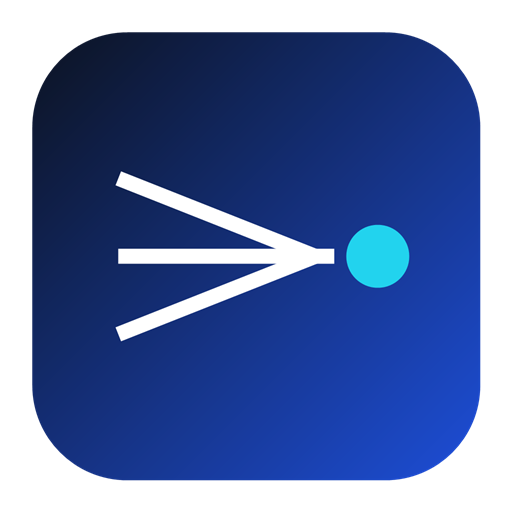

# ModelPort

<p align="center">
  
</p>

<p align="center">
  
  
  <br>
  <a href="https://www.electronjs.org/"></a>
  <a href="https://react.dev/"></a>
  <a href="https://www.typescriptlang.org/"></a>
  
</p>

<p align="center">
  <strong><a href="README.md">English</a> | <a href="https://github.com/polite0803/ModelPort">GitHub</a> | <a href="https://github.com/polite0803/ModelPort/releases">版本发布</a></strong>
</p>

<p align="center">
  <strong>把你手上的模型统一收进一个本地端口</strong>
</p>

<p align="center">
  ModelPort 将任意 OpenAI 兼容端点汇总为一份本地 API。内置 `opencode` 本机运行时、73 条带 Key /
  免密的聚合渠道目录（含 Kilo 免费池）、十个带账号池与积分账本的浏览器 / 设备码登录渠道，以及自定义供应商，
  让任何 OpenAI 兼容客户端即刻可用。
</p>


## ✨ 功能特性

- OpenAI 兼容 API：提供标准 OpenAI 兼容接口，无缝对接现有工具
- 多服务商支持：73 条聚合渠道（API Key / 免费额度 / 本机）、10 个账号渠道以及自定义供应商
- 账号渠道：浏览器 / 设备码登录，自带账号池、每日积分领取、模型积分权重与免费模型标注
- 模型在线刷新：在线重新拉取渠道模型，可关闭单个模型，也可恢复被上游标记失效的模型
- 🆕 上下文管理：智能对话上下文管理，支持滑动窗口、Token 限制和总结压缩策略
- 🆕 工具调用支持：通过提示词工程为所有模型提供通用工具调用能力，兼容 Cherry Studio、Kilo Code 等客户端
- 🆕 模型映射：灵活的模型名称映射，支持通配符和首选服务商/账户选择
- 🆕 自定义参数：支持自定义 HTTP Header 开启联网搜索、深度思考、深度研究等功能
- 仪表盘监控：实时请求流量、Token 使用量和成功率统计
- API Key 管理：为本地代理生成和管理密钥
- 请求日志：详细的请求日志记录，便于调试和分析
- 代理配置：灵活的代理设置和路由策略
- 系统托盘集成：从菜单栏快速访问状态
- 多语言支持：支持英文和简体中文
- 现代界面：简洁响应式界面，支持深色/浅色主题

## 🤖 支持的服务商

| 供应商类别 | 认证类型 | 数量 | 说明 |
| ---------- | -------- | ---- | ---- |
| `opencode`（本机运行时） | 无需凭据 | 1 | 启动本地 agent 运行时；模型列表来自运行时而非某个端点 |
| 聚合目录 | API Key / 无 | 73 条 / 473 个模型 | 支持 openai-chat 与 anthropic-messages 两种线路；含 Kilo 免密免费池 |
| 账号渠道 | 浏览器 / 设备码登录 | 10 个渠道 | 每个渠道维护自己的账号池、每日积分领取与模型门禁 |
| 自定义供应商 | 自行配置 | — | 任意你定义的 OpenAI 兼容 HTTP 端点 |

聚合目录可在**聚合渠道**页面浏览，每条列出其类别（API Key / 免费额度 / 本机）、线路协议与模型数。保存一条渠道会创建带命名空间模型名（`provider/model`）的供应商记录；未保存的条目不会出现在供应商列表里。需要 Google ADC 的条目会被列出但标记为不支持。

**账号渠道**页面覆盖十个登录渠道（`lobsterai`、`qoder`、`qodercn`、`trae`、`cline`、`loomy`、`raccoon`、`minimax`、`zcode`、`gemini`）。模型名会带上游的积分倍率，共三种形态（`· x4.0`、`· x0.2→x0.1`、`· 免费`），挑选模型前即可看到消耗；免费模型会单独标注，上游不再报告健康的模型也能在同一面板里恢复。

供应商适配说明见 [docs/providers](docs/providers/README.md)；`opencode` 运行时说明见 [docs/providers/opencode.md](docs/providers/opencode.md)。

## 📥 安装

### 下载安装

从 [GitHub Releases](https://github.com/polite0803/ModelPort/releases) 下载最新版本：

| 平台                  | 下载文件                             |
| --------------------- | ------------------------------------ |
| macOS (Apple Silicon) | `ModelPort-x.x.x-arm64.dmg`          |
| Windows               | `ModelPort-x.x.x-x64-setup.exe`      |
| Linux                 | `ModelPort-x.x.x-x64.AppImage` 或 `.deb` |

### 从源码构建

**环境要求：**

- Node.js 18+
- npm
- Git

```bash
# 克隆仓库
git clone https://github.com/polite0803/ModelPort.git
cd ModelPort

# 安装依赖
npm install

# 启动开发服务器
npm run dev
```

### 构建生产版本

```bash
npm run build              # 构建应用
npm run build:mac          # 构建 macOS 版本（仅 dmg）
npm run build:win          # 构建 Windows 版本 (nsis)
npm run build:linux        # 构建 Linux 版本 (AppImage, deb)
npm run build:all          # 构建所有平台
```

## 📖 使用方法

### 步骤 1：启动应用

安装完成后，启动 ModelPort。您将看到主仪表盘。

### 步骤 2：添加供应商

1. 从侧边栏导航到**聚合渠道**页面
2. 找到一条渠道（例如 `kilo` 即为免密免费池，或任意 API Key 条目）
3. 点击**配置**，条目需要 Key 时粘贴 API Key，也可覆盖 Base URL 或模型列表
4. 保存后该供应商出现在**供应商**页，模型名为 `<provider>/<model>`

Kilo 这类免密条目无需凭证：保存时会创建一个空的本地账户，可立即路由。Base URL 含
`{placeholders}` 的条目（Azure、Vertex）必须先用你自己的端点覆盖才能保存。

若是登录类渠道，打开**账号渠道**页面选择渠道，通过内置浏览器完成登录，再启用想暴露的模型。模型列表随时可以在线刷新。

### 步骤 3：配置代理

1. 从侧边栏导航到**代理设置**页面
2. 设置端口（默认：8080）
3. 选择负载均衡策略：
   - **轮询**：在账户间均匀分配请求
   - **填充优先**：使用一个账户直到达到限制
   - **故障转移**：失败时自动切换
4. 点击**启动代理**

### 步骤 4：测试 API

使用 Python (OpenAI SDK)：

```python
from openai import OpenAI

client = OpenAI(
    api_key="your-api-key",
    base_url="http://localhost:8080/v1"
)

response = client.chat.completions.create(
    model="kilo/kilo-auto/free",
    messages=[
        {"role": "user", "content": "你好，你是谁？"}
    ]
)

print(response.choices[0].message.content)
```

### 步骤 5：管理 API Key（可选）

为了安全，您可以启用 API Key 认证：

1. 转到 **API Keys** 页面
2. 点击**新建 API Key**
3. 输入名称和描述
4. 复制生成的密钥

## 📸 截图

| 仪表盘 | 服务商 |
|--------|--------|
|  |  |

| 代理设置 | API Key |
|----------|---------|
|  |  |

| 模型管理 | 会话管理 |
|----------|----------|
|  |  |

## ⚙️ 设置选项

- **端口**：更改代理监听端口（默认：8080）
- **路由策略**：轮询（Round Robin）或填充优先（Fill First）
- **自动启动**：应用启动时自动启动代理
- **主题**：浅色、深色或跟随系统
- **语言**：英文或简体中文

## 🏗️ 项目结构

```
ModelPort/
├── src/
│   ├── main/                    # Electron 主进程
│   │   ├── index.ts             # 应用入口
│   │   ├── proxy/               # 代理服务器（Koa）
│   │   ├── ipc/                 # IPC 处理器
│   │   ├── providers/           # 内置 / 聚合 / 账号渠道配置
│   │   ├── channelPack/         # 渠道包宿主（worker + compat 垫片）
│   │   ├── store/               # 持久化存储
│   │   └── tray/                # 系统托盘集成
│   ├── preload/                 # 上下文桥接
│   ├── renderer/                # React 前端
│   │   ├── components/          # UI 组件
│   │   ├── pages/               # 页面组件
│   │   ├── stores/              # Zustand 状态
│   │   └── i18n/                # 国际化
│   └── shared/                  # 主进程与渲染进程共享类型
├── build/                       # 构建资源
├── resources/                   # 运行时随附资源
├── scripts/                     # 构建脚本
└── tests/                       # Node 测试套件
```

## 🔧 技术栈

| 组件   | 技术                    |
| ---- | --------------------- |
| 框架   | Electron 33+          |
| 前端   | React 18 + TypeScript |
| 样式   | Tailwind CSS          |
| 状态管理 | Zustand               |
| 构建工具 | Vite + electron-vite  |
| 打包工具 | electron-builder      |
| 服务器  | Koa                   |

## 📁 数据存储

应用数据存储在 `~/.chat2api/` 目录下（刻意保持不变，老用户的账号与密钥可直接沿用）：

- `data.json` - 配置、服务商、账户与应用日志（单一 electron-store 文件）
- `store.key` - 本机数据密钥，由系统钥匙串封装
- `request-logs/` - 请求明细日志
- `channel-pack/` - 渠道包自身状态与加密后的渠道凭证

账户凭证在系统钥匙串可用时会再加密一层；不可用时将以明文写入 `data.json`。

## ❓ 常见问题

### macOS 提示"应用已损坏，无法打开"？

由于 macOS 的安全机制，非 App Store 下载的应用可能会触发此提示。运行以下命令即可修复：

```bash
sudo xattr -rd com.apple.quarantine "/Applications/ModelPort.app"
```

### 如何更新？

在 **关于** 页面检查更新，或从 [GitHub Releases](https://github.com/polite0803/ModelPort/releases) 下载最新版本。

## 🤝 贡献

1. Fork 本项目
2. 创建功能分支 (`git checkout -b feature/amazing-feature`)
3. 提交更改 (`git commit -m 'Add amazing feature'`)
4. 推送到分支 (`git push origin feature/amazing-feature`)
5. 提交 Pull Request

## 📄 许可证

GNU 通用公共许可证 v3.0。详见 [LICENSE](LICENSE)。

这意味着：

- ✅ 可以自由使用、修改和分发
- ✅ 衍生作品必须以相同许可证开源
- ✅ 必须保留原始版权声明

## 🙏 致谢

- [Electron](https://www.electronjs.org/) - 跨平台框架
- [React](https://react.dev/) - UI 框架
- [TypeScript](https://www.typescriptlang.org/) - 类型安全的 JavaScript
- [Tailwind CSS](https://tailwindcss.com/) - CSS 框架
- [Zustand](https://zustand-demo.pmnd.rs/) - 状态管理
- [Koa](https://koajs.com/) - HTTP 服务器
